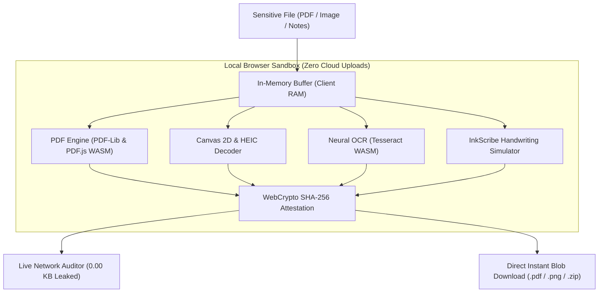

# ✍️ Docuvate (v3.1.0 Release)

> **The 100% Private, Client-Side Document & Visual Workstation Suite**  
> *Zero Server Uploads • Zero Third-Party CDN Dependencies • WebAssembly & WebCrypto Powered • Installable Offline PWA*

---

## 🌟 What is Docuvate?

**Docuvate** is a world-class, privacy-first web application providing 16 dedicated document and visual engineering studios directly inside your web browser.

Unlike traditional document tools that upload your sensitive documents (passports, tax statements, medical records, contracts) to remote cloud servers, **Docuvate processes 100% of your data locally in your browser's RAM** using WebAssembly, Web Workers, WebCrypto, and HTML5 Canvas.

* **Zero Cloud Uploads:** No server receives or stores your files.
* **Zero Third-Party Dependencies:** All required engines (`pdf-lib`, `pdf.js`, `tesseract.js`, `lucide`, `jszip`, `heic2any`) are downloaded and bundled directly inside the local `vendor/` directory. No external CDNs, no tracking, and no external points of failure.
* **100% Airplane-Mode Capable:** Pre-cached by a Service Worker (`sw.js`) so the entire workstation operates seamlessly with zero internet connectivity.
* **Global Launch Kit:** Complete marketing and launch collateral available in [LAUNCH_KIT.md](LAUNCH_KIT.md).

---

## 🏗️ Architecture & Sandboxed Processing Flow

---

## 🚀 Dedicated Tool Studios & Workstations

Docuvate provides dedicated, full-screen studio pages with tailored controls and live interactive canvases:

### 📑 PDF Workstations
* **[Merge PDF Studio](merge-pdf.html):** Multi-file drag-and-drop workbench with visual reordering.
* **[Split & Extract PDF Studio](split-pdf.html):** Visual thumbnail grid with custom page range slicing (`1-3, 5`) and All/Odd/Even quick selectors.
* **[Compress PDF Studio](compress-pdf.html):** Iterative target KB ceiling compression (50KB, 100KB, 200KB, 500KB).
* **[Compress PDF to 100KB](compress-pdf-to-100kb.html):** Dedicated high-speed portal for government job applications.
* **[Sign & Stamp PDF Studio](sign-pdf.html):** Official vector status stamps (`APPROVED`, `CONFIDENTIAL`, `DRAFT`, `VERIFIED`, `ATTESTED`), drawn signature pad, ink color selection, and multi-page signing.
* **[PDF to Image Converter](pdf-to-image.html):** Render PDF pages into 150/300 DPI high-definition JPG/PNG images with 1-click batch ZIP download.
* **[Image to PDF Converter](image-to-pdf.html):** Combine photos, receipts, and scans into a clean formatted A4 PDF.
* **[Organize & Rotate PDF](organize-pdf.html):** Visual page cards to rotate 90° clockwise/counter-clockwise, delete pages, and reorganize document structure.
* **[Protect & Unlock PDF](protect-pdf.html):** Password encryption and permission locks directly in your browser.
* **[OCR Text Extractor](ocr-pdf.html):** Extract text from scanned PDFs and photos using client-side Tesseract.js neural models with live progress and `.txt` export.

### 🖼️ Visual & Image Workstations
* **[Image Resizer in KB](image-resizer-kb.html):** Binary-search compression strictly under 20KB, 50KB, or 100KB for UPSC, SSC, IBPS, and state PSC application portals.
* **[Precision Image Cropper](crop-image.html):** Interactive crop tool with preset aspect ratios (1:1, 16:9, 4:3, 3:2, Circular) and instant lossless export.
* **[Biometric Passport Photo Studio](passport-photo.html):** Official ICAO biometric facial guide overlay (Crown boundary, Eye Line 50%–69%, Chin baseline) and printable 6×4 photo sheets.
* **[Convert Image Formats](convert-image.html):** Batch convert between JPG, PNG, WEBP, and Apple iPhone HEIC/HEIF camera photos.

### ✒️ Digital Handwriting & Govt Utilities
* **[InkScribe Handwriting Studio](inkscribe.html):** Convert digital text, notes, and DOCX/PDF assignments into natural human handwriting with organic tilt drift, authentic paper textures (ruled, graph, vintage parchment, legal yellow pad), and custom font uploads.
* **[Odisha e-District Downloader](certificate-downloader.html):** Independent public gateway for citizens to download issued government certificates (Caste, Residence, Income, Legal Heir) with 8-character token routing.

---

## 🔒 Military-Grade Privacy & Live Network Auditor

Docuvate includes an active **Live Network Auditor** with an interactive security badge:
* **Zero Cloud Uploads:** Intercepts external requests to guarantee zero user file bytes leave your computer.
* **WebCrypto SHA-256 Checksums:** Calculates native cryptographic hashes in real time to verify document integrity.
* **Live Audit Modal:** Click the **Live Audit** badge in the header anytime to view real-time transmission metrics (0.00 KB leaked).
* **Session Purge & RAM Wiper:** Instantly wipe in-memory buffers and revoke blob URLs with 1 click.

---

## 📱 Progressive Web App (PWA) & True Offline Support

Docuvate is a certified **Progressive Web App**:
* Installable on **Windows, macOS, Linux, ChromeOS, iOS, and Android**.
* Backed by **Service Worker (`sw.js`)** pre-caching all app shells, local styles, and local `vendor/` libraries.
* Operates 100% offline with zero internet connectivity.

---

## 🛠️ Technology Stack

| Layer | Technologies & Bundled Vendor Libraries |
| :--- | :--- |
| **Core Architecture** | Pure Vanilla HTML5, Modern CSS3, ECMAScript 2022+ |
| **Design System** | Single master stylesheet `css/style.css` (Obsidian Dark & Apple Light theme system) |
| **Application Engine** | Single master script `js/app.js` (Unified router, state, crypto, and studio engines) |
| **PDF Engineering** | `vendor/pdf-lib.min.js`, `vendor/pdf.min.js`, `vendor/pdf.worker.min.js` |
| **Vision & Neural OCR** | `vendor/tesseract.min.js` (Client-side WebAssembly OCR engine) |
| **Image & Format Engine** | `vendor/heic2any.min.js` (Apple HEIC decoder), HTML5 Canvas 2D |
| **Packaging & Export** | `vendor/jszip.min.js`, `vendor/jspdf.umd.min.js`, `vendor/html2canvas.min.js`, `vendor/qrcode.min.js` |
| **Iconography** | `vendor/lucide.min.js` (Bundled locally) |

---

## 👨‍💻 Author & Lead Architect

**Docuvate** is designed and engineered by **[Raj Kishor Mahapatra](https://itsrkmahapatra.qzz.io/)**.  
Licensed under the [MIT License](LICENSE).
